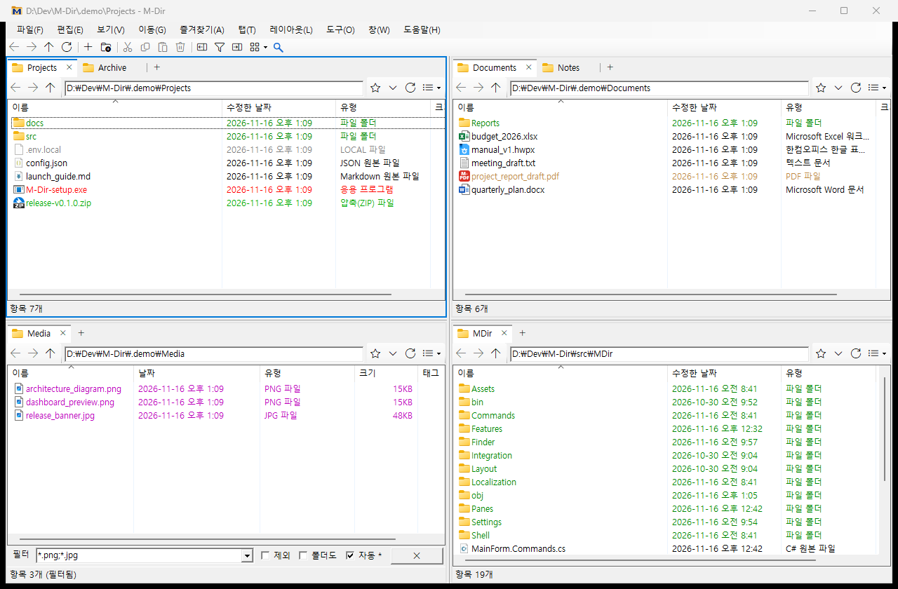
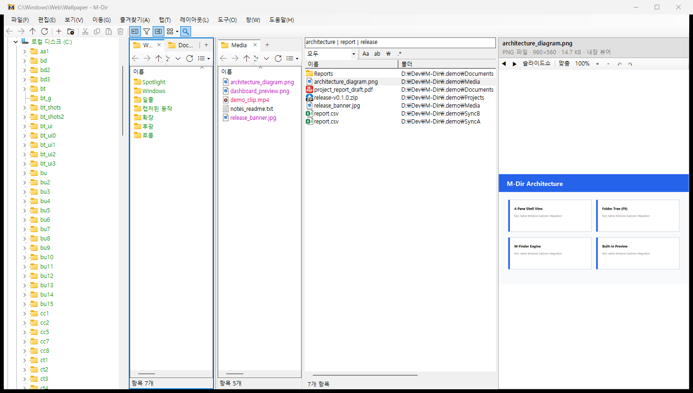
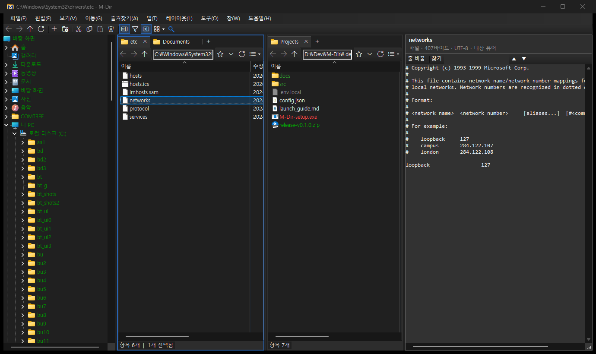
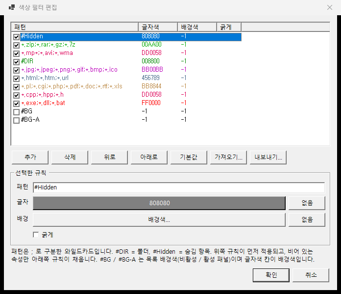
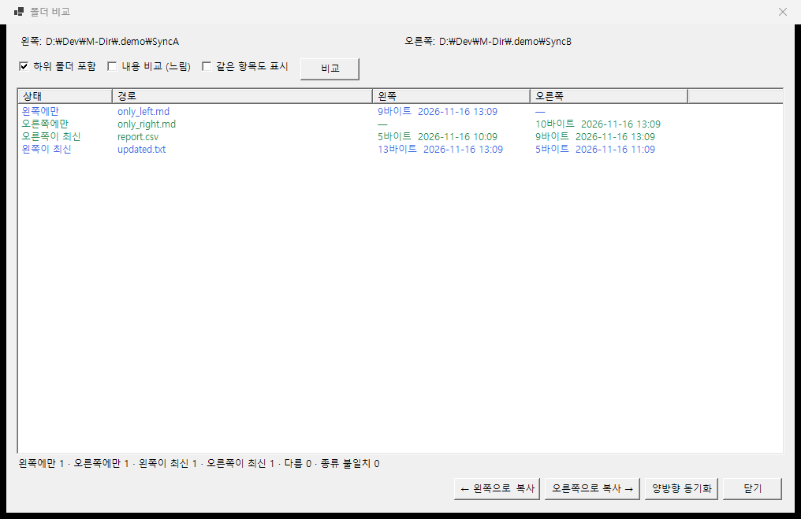
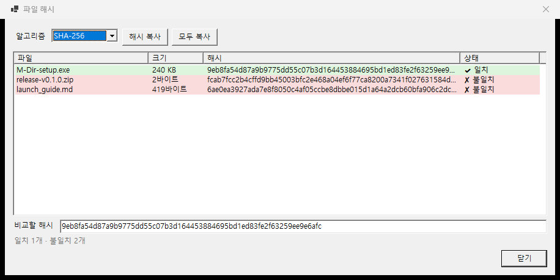

# M-Dir

**Windows 탐색기와 동일한 셸 경험을 그대로 유지하면서, 1~4분할 멀티 패널·다중 탭·폴더 트리·색상/파일 필터·내장 고속 검색(M-Finder)·다기능 미리보기(이미지·텍스트·PDF·Office·한글 HWP/HWPX)를 제공하는 Windows 10/11용 파일 관리자입니다.**

[Q-Dir](https://www.softwareok.com/?seite=Freeware/Q-Dir)의 다중 패널 작업 흐름에서 영감을 받아 .NET 10(C# / WinForms)과 Windows Shell COM(`IExplorerBrowser`, `INameSpaceTreeControl2`, `IFileOperation`, `IPreviewHandler`)을 기반으로 독자 구현했습니다. Windows 탐색기의 우클릭 메뉴·썸네일·그룹화·드래그 앤 드롭·가상 폴더(내 PC, 휴지통, 네트워크, ZIP 내부 등)를 그대로 사용할 수 있습니다.

---

## 목차

- [주요 화면 스크린샷](#주요-화면-스크린샷)
- [설치 및 실행 방법](#설치-및-실행-방법)
  - [포터블 모드 vs 일반 모드](#포터블-모드-vs-일반-모드)
  - [소스 코드에서 빌드 및 배포](#소스-코드에서-빌드-및-배포)
- [핵심 기능 안내](#핵심-기능-안내)
  - [1. 1~4분할 멀티 패널 & 13종 레이아웃](#1-14분할-멀티-패널--13종-레이아웃)
  - [2. 패널별 다중 탭 & 스마트 주소창](#2-패널별-다중-탭--스마트-주소창)
  - [3. 공용/패널별 폴더 트리](#3-공용패널별-폴더-트리)
  - [4. 색상 필터 & 파일 필터](#4-색상-필터--파일-필터)
  - [5. 내장 M-Finder 고속 검색 창](#5-내장-m-finder-고속-검색-창)
  - [6. 다기능 미리보기 창 (한글 HWP/HWPX 포함)](#6-다기능-미리보기-창-한글-hwphwpx-포함)
  - [7. 작업 공간(.mdr) & Q-Dir 가져오기](#7-작업-공간mdr--q-dir-가져오기)
  - [8. 즐겨찾기 & 퀵링크](#8-즐겨찾기--퀵링크)
  - [9. 실용 파일 도구 모음](#9-실용-파일-도구-모음)
  - [10. 화면 사용자화 & Windows 시스템 통합](#10-화면-사용자화--windows-시스템-통합)
- [기본 단축키 일람](#기본-단축키-일람)
- [명령줄 실행 옵션](#명령줄-실행-옵션)
- [설정 및 데이터 파일 구조](#설정-및-데이터-파일-구조)

---

## 주요 화면 스크린샷

### 1. 기본 4분할 화면 (다중 탭 · 파일 필터 · 색상 필터 · 아이콘 툴바)

> 최대 4개의 탐색기 패널을 한 창에서 동시에 조작할 수 있습니다. 각 패널은 독립적인 탭, 주소창, 보기 모드(자세히/큰 아이콘/미리 보기 등), 파일 필터 막대(`Ctrl+Shift+F`), 상태 표시줄을 가지며, 확장자·폴더·숨김 속성에 따라 색상이 구분됩니다.

### 2. 공용 폴더 트리 + 내장 M-Finder 검색 + 미리보기 창

> 왼쪽의 공용 폴더 트리(`F9`), 가운데 다중 패널, 오른쪽의 내장 **M-Finder** 고속 검색 창(`Ctrl+Shift+M`), 가장 오른쪽의 **미리보기 창**(`F12`)을 나란히 배치할 수 있습니다. M-Finder 검색 결과를 선택하면 미리보기 창에 즉시 표시됩니다.

### 3. 다크 모드 & 텍스트 미리보기

> **창 > 화면 모드**에서 밝게·어둡게·시스템 설정 따르기를 선택할 수 있습니다. 다크 모드에서는 창 제목 표시줄·툴바·탭·폴더 트리·파일 목록·미리보기 창 전체가 어두운 테마로 전환되며, 색상 필터의 글자색도 어두운 배경에 맞게 대비(4.5:1 이상)가 자동으로 보정됩니다.

### 4. 주요 부가 도구 화면
| 색상 필터 편집 | 폴더 비교 및 동기화 | 파일 해시 검증 |
| :---: | :---: | :---: |
|  |  |  |

---

## 설치 및 실행 방법

### 시스템 요구 사항
- **운영체제**: Windows 10 / Windows 11 (x64, 또는 소스 빌드 시 arm64)

### 방법 1: 배포 패키지(ZIP)로 바로 실행하기 (권장)

용도에 따라 두 가지 배포본이 제공됩니다(`publish.ps1`로 빌드):

| 패키지 | 실행 파일 크기 (ZIP 크기) | .NET 런타임 필요 여부 | 추천 대상 |
|---|---|---|---|
| **자체 포함(Standard)**<br>`M-Dir-<버전>-win-x64.zip` | 단일 exe 약 47.3 MB<br>(ZIP 약 41.9 MB) | **불필요** (.NET 내장) | 별도 런타임 설치 없이 바로 실행하려는 사용자 |
| **경량(Lite)**<br>`M-Dir-<버전>-win-x64-lite.zip` | 단일 exe 약 1.1 MB<br>(ZIP 약 511 KB) | **[.NET 10 Desktop Runtime](https://dotnet.microsoft.com/download/dotnet/10.0) 필요** | 이미 .NET 10 데스크톱 런타임이 설치된 PC |

1. 원하는 버전의 `.zip` 파일을 다운로드합니다.
2. `C:\Tools\M-Dir` 등 원하는 폴더에 압축을 풉니다. (압축 내에는 `M-Dir.exe`, 빈 `M-Dir.ini`, `Lang\README.txt`가 들어 있습니다.)
3. `M-Dir.exe`를 실행합니다.

### 포터블 모드 vs 일반 모드

M-Dir은 실행 파일(`M-Dir.exe`)과 같은 폴더에 `M-Dir.ini` 파일이 존재하는지 여부로 동작 모드를 자동 결정합니다.

| 구분 | 포터블 모드 (ZIP 기본값) | 일반(사용자 프로필) 모드 |
|---|---|---|
| **전환 방법** | `M-Dir.exe` 옆에 `M-Dir.ini` 파일 유지 | `M-Dir.exe` 옆의 `M-Dir.ini` 파일 삭제 후 실행 |
| **데이터 저장 위치** | `M-Dir.exe`가 있는 폴더 내부 | `%APPDATA%\M-Dir` |
| **레지스트리 사용** | **안 함** (USB·이동식 환경에 적합) | Windows 시작 시 실행 / 탐색기 우클릭 메뉴 등록 가능 |

### 방법 2: 소스 코드에서 직접 빌드 및 배포

사전 준비: [.NET 10 SDK](https://dotnet.microsoft.com/download/dotnet/10.0), Git

```powershell
# 1. 저장소 복제
git clone <repository-url>
cd M-Dir

# 2. 빌드 및 바로 실행
dotnet build MDir.slnx
dotnet run --project src/MDir

# 3. 배포 패키지 생성 (artifacts\ 폴더에 Standard + Lite 실행 파일 및 포터블 ZIP 생성)
.\publish.ps1
# ARM64용 빌드 시:
.\publish.ps1 -Runtime win-arm64

# 4. 테스트 실행
dotnet test MDir.slnx
```

---

## 핵심 기능 안내

### 1. 1~4분할 멀티 패널 & 13종 레이아웃
- **13가지 화면 분할**: `레이아웃` 메뉴(`Alt+L`) 또는 툴바의 레이아웃 아이콘 드롭다운에서 1패널, 2패널(좌우/상하), 3패널(3열/3행/좌1+우2/좌2+우1/상1+하2/상2+하1), 4패널(2×2 세로·가로 기준/세로 4열/가로 4행) 중 즉시 전환할 수 있습니다.
- **분할선 조절**: 패널 사이의 경계선을 드래그해 비율을 자유롭게 조절하거나, **더블클릭**해 기본 균등 비율로 되돌릴 수 있습니다.
- **패널 간 빠른 이동 및 전송**:
  - `F6` / `Shift+F6` 또는 `Ctrl+Alt+1~4`로 활성 패널을 전환합니다(활성 패널은 파란색 테두리로 표시).
  - 파일을 선택한 뒤 `Ctrl+Alt+C`(다음 패널로 복사) 또는 `Ctrl+Alt+M`(다음 패널로 이동)으로 반대편 패널에 바로 전달할 수 있습니다. `편집 > 다른 패널로` 메뉴에서 1~4번 패널을 직접 고를 수도 있습니다.
- **비동기 파일 작업**: 복사·이동·붙여넣기·삭제(`Delete`/`Shift+Delete`)는 별도 STA 스레드에서 실행되므로, 대용량 폴더를 작업하는 동안에도 다른 패널 탐색과 미리보기가 멈추지 않습니다.

### 2. 패널별 다중 탭 & 스마트 주소창
- **패널별 탭 관리**: `Ctrl+T`(새 탭), `Ctrl+W`(탭 닫기), `Ctrl+Tab` / `Ctrl+Shift+Tab`(탭 전환), 탭 복제, 탭 드래그 순서 변경을 지원합니다. 탭을 가운데 클릭하거나 더블클릭해 닫고, 빈 탭 영역을 더블클릭해 새 탭을 열 수 있습니다.
- **여러 줄 탭**: `탭 > 여러 줄 탭`으로 탭이 많을 때 여러 줄로 펼쳐 볼 수 있습니다.
- **스마트 주소창** (`F4`, `Alt+D`, `Ctrl+L`):
  - 일반 폴더 경로뿐 아니라 `shell:MyComputerFolder`, `shell:RecycleBinFolder` 같은 Windows 셸 경로 입력과 경로 자동 완성을 지원합니다.
  - 주소창에서 `Alt+Enter`를 누르면 현재 탭 대신 **새 탭**에서 해당 경로를 엽니다.
  - 주소창 오른쪽 드롭다운(▼)에서 드라이브 및 자주 쓰는 특수 폴더로 빠르게 이동할 수 있습니다(`Ctrl+클릭` 시 새 탭).
- **폴더별 열·정렬 기억**: 폴더 종류(일반, 사진, 음악, 다운로드 등)별로 열 구성과 정렬 상태를 기억해 같은 종류의 폴더를 열 때 일관되게 적용합니다. (보기 메뉴의 **열·보기 모드**는 아주 큰 아이콘, 큰 아이콘, 보통 아이콘, 작은 아이콘, 목록, 자세히, 타일, 내용 8종 지원)

### 3. 공용/패널별 폴더 트리
- **`F9`**(또는 툴바의 트리 아이콘)로 폴더 트리를 켜고 끌 수 있습니다.
- **두 가지 트리 모드** (`보기` 메뉴):
  - **패널별 트리**: 각 패널 안쪽 왼쪽에 해당 패널 전용 트리를 표시합니다.
  - **공용 트리**: 창 왼쪽에 하나의 트리를 두고 활성 패널을 따라가도록 연동합니다.
- **트리 옵션** (`보기 > 트리 옵션`): 연결선 표시, 전체 행 선택, 한 번 클릭으로 펼치기, 현재 폴더 자동 펼치기, 들여쓰기 크기(기본/12/24/32픽셀)를 설정할 수 있으며, 색상 필터의 폴더 규칙(`#DIR`)이 트리 항목 색상에도 함께 적용됩니다.

### 4. 색상 필터 & 파일 필터
- **파일 필터 (`Ctrl+Shift+F`)**: 각 패널 하단에 필터 막대를 열어 현재 패널에 보일 항목을 즉시 걸러냅니다.
  - `;` 또는 `,`로 여러 패턴 구분 (예: `*.png;*.jpg`)
  - **제외** 체크박스: 지정한 패턴을 숨김 (예: `Thumbs.db;*.bak;*.tmp`)
  - **폴더도** 체크박스: 폴더에도 필터 적용 여부 선택
  - **자동 `*`**: 와일드카드(`*`, `?`) 없는 낱말 하나만 입력 시 `*단어*`로 자동 확장
  - 최근 사용한 필터 최대 20개 자동 기억
- **색상 필터 (`보기 > 색상 필터 편집`)**:
  - 위에서부터 순서대로 평가하며 확장자(`*.exe;*.dll;*.bat`, `*.zip;*.7z`, `*.jpg;*.png` 등), 폴더(`#DIR`), 숨김 항목(`#Hidden`), 패널 배경(`#BG` 비활성 / `#BG-A` 활성)의 글자색·배경색·굵게를 지정할 수 있습니다.
  - Q-Dir의 `[Filter2]` 색상 규칙을 가져오거나 내보낼 수 있습니다.

### 5. 내장 M-Finder 고속 검색 창
- **`Ctrl+Shift+M`**(또는 툴바 오른쪽의 돋보기 아이콘)으로 패널 오른쪽에 **M-Finder** 검색 창을 엽니다.
- **외부 프로그램 설치 없이 즉시 동작**: C# 내장 검색 엔진(`FinderEngine`)이 내장되어 있어 별도 프로그램 없이 색인 및 실시간 검색을 수행합니다. (원하는 경우 `도구 > M-Finder 설정`에서 기존 외부 M-Finder 실행 파일이나 소스를 연결할 수도 있습니다.)
- **NTFS MFT 초고속 색인**: `도구 > M-Finder 설정`에서 NTFS 드라이브 MFT 직접 스캔(최초 허용 시 UAC 확인을 통해 관리자 권한 도우미로 파일 메타데이터만 빠르게 수집) 또는 일반 폴더 스캔을 선택할 수 있으며, 파일 변경 사항을 실시간 감시해 색인을 자동 유지합니다.
- **강력한 검색 문법**:
  - **논리 연산**: 공백 = AND, `|` = OR, `!` = NOT, `< >` = 그룹핑, `"..."` = 구문 일치
  - **종류 매크로**: `pic:`(이미지), `doc:`(문서·HWP/HWPX 포함), `video:`, `audio:`, `zip:`(압축), `exe:`(실행 파일), `folder:`, `file:`, `empty:`
  - **속성·조건 함수**: `ext:pdf;hwpx`, `size:>10mb`, `size:1mb..50mb`, `dm:today` / `dm:last7days` / `dm:2026-11-01..2026-11-16`(수정일 `dm:`, 생성일 `dc:`, 접근일 `da:`), `content:검색어`(텍스트 및 PDF 본문 검색), `parent:경로`, `depth:1..3`, `attrib:h;r`
  - **옵션 토글 및 수식어**: UI 토글(`Aa` 대소문자 구분, `ab` 단어 단위, `\` 전체 경로, `.*` 정규식) 및 인라인 수식어(`case:`, `regex:`, `ww:`, `path:`, `startwith:`, `endwith:`)
- **목록·미리보기 연동**: 검색 결과를 클릭하면 오른쪽 미리보기 창이 즉시 내용을 보여 주며, `Enter`로 열기(폴더는 활성 패널에서 열기), `Ctrl+Enter`로 해당 폴더 위치로 이동 및 선택할 수 있습니다.

### 6. 다기능 미리보기 창 (한글 HWP/HWPX 포함)
- **`F12`**(또는 툴바 미리보기 아이콘)로 창 오른쪽에 미리보기 창을 엽니다.
- **파일 형식별 최적 뷰어**:
  - **한글 문서 (`.hwp`, `.hwpx`) — 내장 한글 뷰어**: 한컴오피스가 설치되어 있지 않아도 HWP(OLE 복합 파일)/HWPX(OWPML) 문서를 직접 해석해 글꼴·크기·색상·정렬·들여쓰기·표(병합·배경·테두리)·그림·글상자·용지 여백이 반영된 **전체 쪽**을 HTML로 렌더링해 보여 줍니다. (암호·배포용·DRM 문서는 시스템 한컴 미리보기 처리기로 자동 폴백)
  - **이미지 (`.png`, `.jpg`, `.gif`, `.bmp`, `.tif`, `.ico` 등)**: 내장 이미지 뷰어로 EXIF 회전 방향을 자동 보정하며, 창 맞춤 / 100% 실제 크기 / 확대·축소(마우스 휠) / 좌우 회전 / 이전·다음(`◀` `▶`) / 3초 간격 **슬라이드쇼**를 지원합니다.
  - **텍스트 및 소스 코드**: UTF-8 / UTF-16 BOM 및 CP949 인코딩 자동 판별, **줄 바꿈** 토글, **본문 찾기**(`Enter` 다음 / `Shift+Enter` 이전)를 제공합니다.
  - **동영상·음악**: Windows Media Player 컨트롤을 통해 재생할 수 있습니다.
  - **기타 문서 (PDF, Office, HTML 등)**: Windows 탐색기와 동일한 `IPreviewHandler` 셸 미리보기 처리기를 대리 프로세스(`prevhost.exe`)로 안전하게 호스팅해 보여 줍니다.
  - **미리보기 미지원 파일·폴더**: 파일 크기, 수정 일시, 폴더 내 항목 수 등 요약 정보 페이지를 표시합니다.

### 7. 작업 공간(`.mdr`) & Q-Dir 가져오기
- **자동 저장 및 복원**: `파일 > 종료 시 저장, 시작 시 복원`이 켜져 있으면 종료 시 현재 레이아웃, 분할선 비율, 패널별 모든 탭, 보기 모드, 열·정렬, 트리·미리보기·M-Finder 상태, 창 위치를 `start.mdr`에 저장했다가 다음 실행 시 그대로 복원합니다.
- **수동 작업 공간**: 업무/프로젝트별로 `.mdr` 파일을 저장(`Ctrl+S`)하고 열어(`Ctrl+O`) 환경을 전환할 수 있습니다.
- **Q-Dir 마이그레이션**: `파일 > Q-Dir 작업 공간 가져오기`로 기존 `.qdr` 파일의 폴더·분할 비율·트리·미리보기 상태를 가져오고, `즐겨찾기 > Q-Dir 즐겨찾기 폴더 가져오기`로 Q-Dir의 `Favoriten` 폴더를 그대로 가져올 수 있습니다.

### 8. 즐겨찾기 & 퀵링크
- **`Ctrl+D`**로 현재 폴더를 즐겨찾기에 추가하거나, 패널 주소창의 ★ 버튼으로 즐겨찾기 메뉴와 **퀵링크**에 바로 접근할 수 있습니다.
- **`Ctrl+Shift+O`**로 **즐겨찾기 정리** 창을 열어 트리 구조에서 드래그 앤 드롭으로 순서 변경·폴더 이동, 이름 바꾸기(`F2`), 아이콘 변경을 할 수 있습니다.
- 즐겨찾기 메뉴에서 항목을 `Ctrl+클릭` 또는 가운데 클릭하면 새 탭으로 열리며, 즐겨찾기 **폴더**를 `Ctrl+클릭`하면 그 안의 모든 바로 가기가 한꺼번에 새 탭으로 열립니다.

### 9. 실용 파일 도구 모음
- **폴더 검색 (`Ctrl+F` / `F3`)**: 지정한 폴더 하위에서 파일명 와일드카드 및 텍스트 본문 검색을 수행하며, 버튼 한 번으로 Windows Search 저장 검색(`.search-ms`) 결과를 새 탭으로 열 수도 있습니다.
- **여러 파일 이름 바꾸기 (`Ctrl+R`)**: `[N]`(이름), `[E]`(확장자), `[C]` / `[C:3]`(번호), `[D]`(수정 날짜), `[P]`(상위 폴더) 마스크와 찾기/바꾸기(정규식 지원), 대소문자 일괄 변환, 실시간 미리보기, 충돌/중복 사전 경고, **직전 작업 되돌리기**를 지원합니다.
- **폴더 비교 및 동기화 (`도구 > 폴더 비교 및 동기화`)**: 활성 패널과 다음 패널의 폴더를 **빠른 비교**(크기 + 수정 시각) 또는 **내용 비교**(SHA-256)로 비교하고, 왼쪽/오른쪽 단방향 복사 또는 최신 버전 기준 **양방향 동기화**(기존 파일 삭제 없음)를 실행합니다.
- **파일 해시 (`도구 > 파일 해시`)**: 선택한 파일들의 `SHA-256`, `SHA-1`, `MD5` 체크섬을 비동기로 계산하고, 검증할 해시값을 붙여 넣으면 일치/불일치를 색상으로 즉시 판별합니다(`sha256sum` 형식 전체 복사 지원).
- **폴더 크기 표시**: 상태 표시줄 수동(`도구 > 폴더 크기 계산`) / 자동(`보기 > 선택한 폴더 크기 자동 계산`) 계산 및 파일 목록의 **크기 열에 폴더 크기 표시**(`보기 > 폴더 크기를 크기 열에 표시`)를 지원합니다.
- **목록 내보내기 & 인쇄**: 현재 목록(또는 선택 항목)을 `TXT`, `CSV`, `HTML`, `XLSX`(Excel) 파일로 내보내거나 인쇄·인쇄 미리 보기(`Ctrl+P`)를 할 수 있습니다.
- **경로 복사 & 여기서 열기 & 하드 링크**: 전체 경로(`Ctrl+Shift+C`)·파일 이름·폴더 경로 복사, 현재 폴더에서 **명령 프롬프트(CMD) / PowerShell / Windows 탐색기 열기**, 동일 NTFS 볼륨 내 **하드 링크 만들기**를 제공합니다.

### 10. 화면 사용자화 & Windows 시스템 통합
- **다크 모드 & UI 배율**: `창 > 화면 모드`(밝게/어둡게/시스템 설정 따르기) 및 `창 > UI 배율`(100%, 125%, 150%, 175%, 200%)을 재시작 없이 즉시 적용합니다.
- **다국어 및 외부 언어 팩**: 한국어와 영어가 기본 내장되어 있으며(`창 > 언어`), `Lang\*.lng` UTF-8 탭 구분 파일(`한국어 원문<TAB>번역`)을 추가해 원하는 언어를 확장할 수 있습니다.
- **도구 모음 및 단축키 편집**: `도구 > 도구 모음 편집`과 `도구 > 단축키 편집`으로 자주 쓰는 기능만 툴바에 배치하고 원하는 키 조합으로 바꿀 수 있습니다.
- **시스템 통합 (`창` 메뉴)**:
  - **전체 화면 (`F11`)**, **메뉴 막대 숨기기 (`Alt+F11`)**, **도구 모음 표시/숨기기**
  - **최소화하면 트레이로**: 창 최소화 시 알림 영역 아이콘으로 숨김
  - **창 하나만 실행 (`SingleInstance`)**: 이미 실행 중인 창이 있으면 새 창을 띄우는 대신 기존 창의 새 탭으로 폴더를 엽니다(재시작 후 적용).
  - **Windows 시작 시 실행** 및 **탐색기 폴더 메뉴에 'M-Dir에서 열기' 등록** (일반 모드에서만 활성화, 현재 사용자 `HKCU`에만 등록)

---

## 기본 단축키 일람

> 모든 단축키는 `도구 > 단축키 편집`에서 자유롭게 변경하거나 해제할 수 있습니다.

| 분류 | 단축키 | 기능 |
|---|---|---|
| **레이아웃 · 패널** | `F6` / `Shift+F6` | 다음 패널 / 이전 패널로 이동 |
| | `Ctrl+Alt+1` ~ `4` | 패널 1 ~ 4로 바로 이동 |
| | `Ctrl+Alt+C` / `Ctrl+Alt+M` | 선택 항목을 다음 패널로 복사 / 이동 |
| **탭 · 탐색** | `Ctrl+T` / `Ctrl+Alt+A` | 새 탭 열기 |
| | `Ctrl+W` | 현재 탭 닫기 |
| | `Ctrl+Tab` / `Ctrl+Shift+Tab` | 다음 탭 / 이전 탭 (`Ctrl+PageDown` / `PageUp`도 동일) |
| | `F4` / `Alt+D` / `Ctrl+L` | 주소창 포커스 (`Alt+Enter`: 입력한 경로를 새 탭에서 열기) |
| | `Alt+←` / `Alt+→` / `Alt+↑` | 뒤로 / 앞으로 / 상위 폴더 |
| | `F5` | 현재 패널 새로 고침 |
| **보기 · 패널 도구** | `F9` | 폴더 트리 표시/숨기기 |
| | `Ctrl+Shift+F` | 파일 필터 막대 표시/숨기기 |
| | `F12` | 미리보기 창 표시/숨기기 |
| | `Ctrl+Shift+M` | M-Finder 고속 검색 창 표시/숨기기 |
| | `F11` / `Alt+F11` | 전체 화면 / 메뉴 막대 숨기기 |
| **파일 · 편집** | `Ctrl+Shift+N` | 새 폴더 만들기 |
| | `Ctrl+C` / `Ctrl+X` / `Ctrl+V` | 복사 / 잘라내기 / 붙여넣기 |
| | `Delete` / `Shift+Delete` | 삭제(휴지통) / 영구 삭제 |
| | `F2` / `Ctrl+Z` | 이름 바꾸기 / 실행 취소 |
| | `Ctrl+A` / `Ctrl+Shift+A` | 모두 선택 / 선택 반전 |
| | `Ctrl+Shift+C` | 선택한 항목의 전체 경로 복사 |
| | `Alt+Enter` | 속성 (파일 목록 포커스 시) |
| **즐겨찾기 · 작업 공간 · 도구** | `Ctrl+D` / `Ctrl+Shift+O` | 현재 폴더 즐겨찾기 추가 / 즐겨찾기 정리 |
| | `Ctrl+N` / `Ctrl+O` / `Ctrl+S` | 새 작업 공간 / 열기 / 저장 |
| | `Ctrl+P` | 목록 인쇄 |
| | `Ctrl+F` 또는 `F3` | 폴더 검색 창 |
| | `Ctrl+R` | 여러 파일 이름 바꾸기 |

---

## 명령줄 실행 옵션

```text
M-Dir.exe [옵션] [폴더 경로 | 작업공간.mdr]
```

| 옵션 | 설명 |
|---|---|
| `<폴더 경로>` | 지정한 폴더를 1번 패널(또는 단일 인스턴스 모드에서는 기존 창의 새 탭)로 엽니다. |
| `<파일.mdr>` | 지정한 작업 공간 파일을 불러옵니다. |
| `-explore` 또는 `/e` | 시작할 때 폴더 트리를 함께 표시합니다. |
| `-new` (또는 `-newinstance`) | `창 하나만 실행` 옵션이 켜져 있어도 별도의 새 창으로 실행합니다. |
| `-minimized` (또는 `-min`) | 최소화된 상태로 시작합니다(`최소화하면 트레이로`가 켜져 있으면 트레이로 시작). |

---

## 설정 및 데이터 파일 구조

| 파일 / 폴더 | 설명 |
|---|---|
| `M-Dir.ini` | 전역 설정(화면 모드, UI 배율, 언어, 트리 옵션, 색상 필터 규칙, 최근 필터, 사용자 단축키, 툴바 구성, M-Finder 설정). UTF-16 INI 형식. |
| `start.mdr` | 마지막 종료 시 자동 저장되는 기본 작업 공간 파일(레이아웃, 분할 비율, 패널별 탭 PIDL, 보기 모드, 열·정렬, 창 위치). |
| `Favorites\` | 즐겨찾기 `.lnk` 바로 가기 및 `Quick-Link\` 폴더, `.order` 정렬 순서 파일. |
| `Finder\index.mfi` | 내장 M-Finder 검색 엔진이 생성하는 색인 데이터베이스. |
| `Lang\<code>.lng` | 추가 언어 팩 폴더(`exe` 옆 또는 데이터 폴더의 `Lang\`). UTF-8 텍스트(`한국어<TAB>번역`). |
